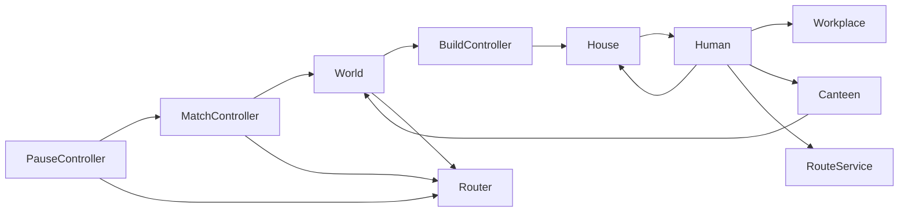

# Аудит архитектуры и качества Proximity Archipelago

> Исторический аудит исходной ветки. Исправления и актуальные проверки перечислены в [отчёте изменений](docs/CHANGE_REPORT.md). Номера строк ниже относятся к исходной ревизии.

Дата: 25 октября 2026 года. Ревизия: `4368c5d31528beb98715776679eeb4863da9bcbe`.

## Вывод для ПМ

Жалоба на недостаточный decoupling обоснована. Главная причина — скрытые зависимости от глобального дерева сцены, конкретных классов и порядка инициализации. Группы используются как глобальный реестр сервисов, но не задают границы отдельного мира. Сигналы местами соседствуют с прямым управлением чужим состоянием.

Наиболее дорогие связи:

- `House` создаёт, настраивает и уничтожает жителей; `Human` знает конкретный `House` и меняет его список жителей.
- `Human` выбирает предприятия, резервирует рабочие места, прокладывает маршруты, двигается, управляет голодом, состояниями и анимационными вызовами.
- `BuildController` совмещает правила размещения, списание ресурсов, создание и уничтожение объектов, учёт занятости и обновление навигации. Внутри есть отдельная политика для `House`.
- Игровые правила вызывают `Router` и меняют глобальную паузу. При этом оболочка знает конкретный `MatchController`.
- Отдельные компоненты находят зависимости через группы, обход родителей, переданные ссылки и строковые поля `payload`. Единого способа сборки мира нет.

Это уже проявляется в ошибках: результат матча может пережить переход в главное меню; второй мир создаёт жителей в первом; неудачная настройка здания всё равно списывает ресурсы.

Ниже 30 замечаний. Архитектурная причина и её конкретное проявление иногда описаны отдельно; это не 30 независимых игровых багов.

## Объём и метод

Прочитаны все 37 GDScript-файлов — 2158 строк, все 13 сцен, 9 `.tres`, `project.godot`, README и настройки репозитория. Проверены оболочка, UI, мир, сущности, строительство, склад, навигация, правила матча и отладочный код.

Проверки выполнены на локальном Godot `4.7.2.stable.arch_linux.ed1daf0bf`. Импорт, запуск и временные проверочные сцены выполнялись в копиях проекта. Исходный игровой код не менялся. Проверки были headless: визуальный интерфейс и полный ручной игровой сеанс не проверялись.

Приоритеты:

- **P1** — нарушает завершение или выход из игровой сессии; исправлять первым.
- **P2** — воспроизводимая ошибка в отдельном сценарии либо существенная архитектурная проблема.
- **P3** — локальное упрощение, ясность контракта или подготовка к расширению.

«Воспроизведено» означает проверку исполняемым сценарием. «Статически» означает вывод из кода. Условные сценарии и неоднозначные требования отмечены отдельно.

## 1. Ошибки поведения и контрактов

### F01 · P1 · Результат матча переживает переход в главное меню

Где: [Router.goto, строки 60–69](/home/izzy/Sources/ITMO/GameDev/third_course/Godot/Proximity_Archipelago/_shell/autoload/router.gd:60), [MatchController._finish, строки 101–122](/home/izzy/Sources/ITMO/GameDev/third_course/Godot/Proximity_Archipelago/game/match/match_controller.gd:101), [выход из паузы](/home/izzy/Sources/ITMO/GameDev/third_course/Godot/Proximity_Archipelago/overlays/pause_menu.gd:18).

`goto()` очищает оверлеи до `await fade_out()`. До уничтожения старого экрана игровой мир продолжает существовать. Если в этот промежуток матч завершается, `_finish()` ставит паузу и открывает новый `MatchResult`. Переход завершается, но новый оверлей уже не очищается.

**Воспроизведено:** `screen="main_menu"`, `paused=true`, `overlay="MatchResult"`. Для воспроизведения завершение матча вызвано внутри открытого интервала перехода; таймер или событие склада могут попасть в тот же интервал.

Исправление: при уходе останавливать игровую сессию и запрещать ей создавать UI. Связать результат с идентификатором активной сессии. Переход и паузу координировать в одном месте.

### F02 · P2 · Глобальные группы смешивают независимые миры

Где: [House._populate](/home/izzy/Sources/ITMO/GameDev/third_course/Godot/Proximity_Archipelago/game/entities/house.gd:52), [поиск работы](/home/izzy/Sources/ITMO/GameDev/third_course/Godot/Proximity_Archipelago/game/entities/human.gd:95), [поиск столовой](/home/izzy/Sources/ITMO/GameDev/third_course/Godot/Proximity_Archipelago/game/entities/human.gd:116), [HUD](/home/izzy/Sources/ITMO/GameDev/third_course/Godot/Proximity_Archipelago/game/match/match_timer_hud.gd:31).

`get_first_node_in_group()` возвращает первый узел во всём `SceneTree`. Поиск предприятий тоже не ограничен миром. Проверка viewport в строительстве не заменяет принадлежность миру.

**Воспроизведено:** два экземпляра мира в одном дереве дали первому `Units` 10 жителей, второму — 0. Жители второго дома получили навигацию первого мира.

Текущий основной экран содержит один мир. Ошибка становится видимой при одновременных экземплярах: тестах, предпросмотре, нескольких аренах. Исправление: передавать локальные зависимости и реестры из конкретного `World`.

### F03 · P2 · Строительство сообщает успех после ошибки настройки здания

Где: [BuildController.try_build](/home/izzy/Sources/ITMO/GameDev/third_course/Godot/Proximity_Archipelago/game/building/build_controller.gd:78), [Building.setup](/home/izzy/Sources/ITMO/GameDev/third_course/Godot/Proximity_Archipelago/game/entities/base_building.gd:13), [House._populate](/home/izzy/Sources/ITMO/GameDev/third_course/Godot/Proximity_Archipelago/game/entities/house.gd:48).

Деньги списываются до `instance.setup()`. `setup()` и `_on_setup()` возвращают `void`, поэтому ошибка настройки не может отменить операцию. Флаг `_is_setup` выставляется до выполнения пользовательского хука.

**Воспроизведено:** дом без `human_scene` вызвал ошибку, списал 20 Wood и остался без жителей. `try_build()` вернул `true`.

Исправление: проверять определение здания до списания. Вернуть результат настройки и предусмотреть отмену неполной операции. Не объявлять объект настроенным до успешного завершения.

### F04 · P2 · Реестр занятости сохраняет уничтоженные объекты

Где: [BuildController._occupied](/home/izzy/Sources/ITMO/GameDev/third_course/Godot/Proximity_Archipelago/game/building/build_controller.gd:11), [reserve_existing](/home/izzy/Sources/ITMO/GameDev/third_course/Godot/Proximity_Archipelago/game/building/build_controller.gd:24), [_clear_occupant](/home/izzy/Sources/ITMO/GameDev/third_course/Godot/Proximity_Archipelago/game/building/build_controller.gd:178), [Building.demolish](/home/izzy/Sources/ITMO/GameDev/third_course/Godot/Proximity_Archipelago/game/entities/base_building.gd:26).

Реестр очищается только через приватный путь `BuildController`. Подписки на `tree_exiting` или `demolished` нет. Прямой публичный `Building.demolish()` либо обычный `queue_free()` оставляет запись и потенциальную блокировку навигации.

**Воспроизведено:** после `Home.free()` запись клетки осталась, а `is_instance_valid()` для её значения вернул `false`.

Исправление: дать реестру владеть регистрацией и удалением всех зданий. Поддержать внешнее удаление через сигнал жизненного цикла. Проверять валидность ссылок перед использованием.

### F05 · P2 · House._prune падает на освобождённом жителе

Где: [House._prune](/home/izzy/Sources/ITMO/GameDev/third_course/Godot/Proximity_Archipelago/game/entities/house.gd:75). Рабочий образец уже есть в [Workplace._prune_workers](/home/izzy/Sources/ITMO/GameDev/third_course/Godot/Proximity_Archipelago/game/entities/workplace.gd:23).

Типизированная лямбда `filter()` принимает `Node2D` до проверки `is_instance_valid()`. Освобождённый объект не проходит преобразование аргумента.

**Воспроизведено:** `add_resident(node)`, `node.free()`, `has_space()` вызвали ошибки преобразования и присваивания массива. Запись жителя сохранилась. Обычный `Human.die()` заранее удаляет жителя; ошибка касается других путей освобождения.

Исправление: применить явный цикл, как в `Workplace`, либо удалять запись по событию выхода жителя.

### F06 · P2 · Существующий house_test больше не работает

Где: [тест](/home/izzy/Sources/ITMO/GameDev/third_course/Godot/Proximity_Archipelago/game/test/house_test.gd:3), [новая зависимость House](/home/izzy/Sources/ITMO/GameDev/third_course/Godot/Proximity_Archipelago/game/entities/house.gd:56).

Тест создаёт `units_root`, но не создаёт `RouteService`. Дом не заселяется, затем тест без проверки обращается к `residents[0]`. Вместо проверок используются `print()`.

**Воспроизведено:** `no node in group route_service`, затем `Out of bounds get index '0'`. Процесс Godot при этом вернул код 0.

Исправление: обновить fixture, добавить реальные проверки и ненулевой код завершения при ошибке. Такой тест должен ловить нарушение зависимостей, а не сам зависеть от скрытой сборки игрового мира.

### F07 · P2 · Стартовое выполнение целей не завершает матч

Где: [MatchController._start](/home/izzy/Sources/ITMO/GameDev/third_course/Godot/Proximity_Archipelago/game/match/match_controller.gd:51), [_on_inventory_changed](/home/izzy/Sources/ITMO/GameDev/third_course/Godot/Proximity_Archipelago/game/match/match_controller.gd:83).

`WorldInventory.configure()` уведомляет наблюдателей раньше подключения `MatchController`. После подключения `_start()` не проверяет цели. Следующая проверка происходит при изменении склада либо по истечении таймера.

**Воспроизведено:** стартовые Wood/Stone/Food по 100, `_targets_met()=true`, `is_finished()=false`.

Исправление: после полной инициализации сразу оценить условия победы. Проверять также корректность списка целей и параметров матча.

### F08 · P2 · Отложенная победа использует старое состояние склада

Где: [планирование _finish](/home/izzy/Sources/ITMO/GameDev/third_course/Godot/Proximity_Archipelago/game/match/match_controller.gd:83), [фиксация результата](/home/izzy/Sources/ITMO/GameDev/third_course/Godot/Proximity_Archipelago/game/match/match_controller.gd:101).

После `_targets_met()` откладывается безусловный вызов `_finish(WIN)`. До его выполнения ресурсы могут быть потрачены. Повторной проверки или снимка состояния на момент достижения нет.

**Воспроизведено:** Food увеличен с 10 до 100, затем в том же кадре потрачен до 0. Получен `WIN` при `_targets_met()=false`.

**Семантика требует решения:** если победа означает однократное достижение порога, сам WIN допустим. Тогда нужно явно фиксировать достижение и соответствующий снимок. Если проверяется итоговый склад после операций кадра, перед завершением нужна повторная проверка. Сейчас результат и показанные запасы отражают разные моменты.

### F09 · P2 · Блокирующее здание одновременно служит недоступной целью маршрута

Где: [SceneBuildOption.blocks_movement](/home/izzy/Sources/ITMO/GameDev/third_course/Godot/Proximity_Archipelago/game/building/scene_build_option.gd:7), [блокировка footprint](/home/izzy/Sources/ITMO/GameDev/third_course/Godot/Proximity_Archipelago/game/building/build_controller.gd:105), [цель маршрута Human](/home/izzy/Sources/ITMO/GameDev/third_course/Godot/Proximity_Archipelago/game/entities/human.gd:148).

Навигация исключает занятые блокирующим зданием клетки. `Human` всегда идёт в клетку центра здания. Входов и доступных соседних точек взаимодействия нет.

**Воспроизведено:** дом с `blocks_movement=true` успешно построился и создал 5 жителей. Маршрут из его клетки в соседнюю оказался недействительным.

В текущем каталоге дома и яблони явно неблокирующие; дефект проявляется при новом блокирующем обслуживаемом здании. Исправление: разделить footprint препятствия, точки входа и точки появления жителей. Проверять их при регистрации определения.

### F10 · P2 · Ошибка нового экрана уничтожает старый и всё равно сообщает успех

Где: [Router._swap_screen](/home/izzy/Sources/ITMO/GameDev/third_course/Godot/Proximity_Archipelago/_shell/autoload/router.gd:74), [завершение Router.goto](/home/izzy/Sources/ITMO/GameDev/third_course/Godot/Proximity_Archipelago/_shell/autoload/router.gd:67), [Manifest.validate](/home/izzy/Sources/ITMO/GameDev/third_course/Godot/Proximity_Archipelago/_shell/manifest.gd:13).

Текущий экран удаляется до проверки корня следующей сцены. `_swap_screen()` не возвращает результат. После ошибки `goto()` продолжает fade-in и испускает `screen_changed(key)`. Неудачный `instantiate() as Screen` также теряет ссылку на созданный неподходящий узел.

**Воспроизведено:** сцена с корнем `Node` оставила `_current=null`, старый `current_key="main_menu"`, событие `screen_changed("invalid")` и один orphan на выходе.

Исправление: сначала создать и проверить следующий экран, затем заменить текущий. Возвращать явный результат перехода и освобождать неподходящий экземпляр.

### F11 · P2 · Чистый импорт даёт ошибку компиляции PauseController

Где: [вывод типа top](/home/izzy/Sources/ITMO/GameDev/third_course/Godot/Proximity_Archipelago/_shell/autoload/pause_controller.gd:21), [autoload через UID](/home/izzy/Sources/ITMO/GameDev/third_course/Godot/Proximity_Archipelago/project.godot:20).

В двух независимых копиях без `.godot` первый `godot --headless --editor --quit` выдал:

```text
Cannot infer the type of "top" variable because the value doesn't have a set type.
```

Затем движок сообщил, что autoload `PauseController` не компилируется. Повторный импорт и обычный запуск уже проходили. Это зависимость начального импорта от состояния разрешения скриптов; постоянной ошибки запуска не обнаружено.

В третьей чистой копии замена строки на `var top: MenuBase = Router.top_overlay()` убрала ошибку первого импорта. Исправление: явно задать тип на этой границе и включить чистый импорт в проверки проекта.

### F12 · P2 · Обе кнопки Settings ведут в незарегистрированные маршруты

Где: [главное меню](/home/izzy/Sources/ITMO/GameDev/third_course/Godot/Proximity_Archipelago/screens/main_menu.gd:9), [пауза](/home/izzy/Sources/ITMO/GameDev/third_course/Godot/Proximity_Archipelago/overlays/pause_menu.gd:12), [manifest](/home/izzy/Sources/ITMO/GameDev/third_course/Godot/Proximity_Archipelago/manifest.tres:14), [MenuBase](/home/izzy/Sources/ITMO/GameDev/third_course/Godot/Proximity_Archipelago/_shell/menu_base.gd:4).

В manifest нет ни экрана, ни оверлея `settings`. Нажатие приводит к ветке `push_error()` в Router. Кроме того, меню паузы ожидает `settings.closed`, хотя базовый контракт предоставляет только `close_requested`. Простое добавление обычного `MenuBase` оставит вторую ошибку.

Статически подтверждено. Исправление: реализовать зарегистрированный маршрут и корректный сигнал либо убрать доступную кнопку до готовности функции.

## 2. Архитектурные причины

### F13 · P2 · Оболочка и игровые правила зависят друг от друга

Где: [PauseController._match_finished](/home/izzy/Sources/ITMO/GameDev/third_course/Godot/Proximity_Archipelago/_shell/autoload/pause_controller.gd:35), [MatchController._finish](/home/izzy/Sources/ITMO/GameDev/third_course/Godot/Proximity_Archipelago/game/match/match_controller.gd:101), [World._unhandled_input](/home/izzy/Sources/ITMO/GameDev/third_course/Godot/Proximity_Archipelago/game/wolrd.gd:66).

Оболочка знает `MatchController`; игровой контроллер знает `Router`, ключ конкретного оверлея и глобальную паузу. `World` обрабатывает мышь и открывает UI. Пауза меняется в `PauseController`, `MatchController` и двух меню. Пустой стек меню безусловно снимает любую паузу.

Это мешает проверять правила без оболочки и создаёт конфликт владельцев состояния. F01 — конкретное проявление. Исправление: экран матча связывает доменные события с UI, навигацией и паузой. `MatchController` только формирует результат. Контроллер паузы хранит причину или владельца паузы.

### F14 · P2 · Инициализация основана на неявном порядке жизненного цикла

Где: [сборка World](/home/izzy/Sources/ITMO/GameDev/third_course/Godot/Proximity_Archipelago/game/wolrd.gd:12), [отложенный старт матча](/home/izzy/Sources/ITMO/GameDev/third_course/Godot/Proximity_Archipelago/game/match/match_controller.gd:31), [поиск HUD](/home/izzy/Sources/ITMO/GameDev/third_course/Godot/Proximity_Archipelago/game/match/match_timer_hud.gd:20), [ожидание DebugProbe](/home/izzy/Sources/ITMO/GameDev/third_course/Godot/Proximity_Archipelago/game/test/debug_probe.gd:29).

Один компонент ждёт deferred-вызов, другой ищет зависимость каждый кадр, третий ждёт кадр. `House.setup()` требует уже созданных глобальных узлов, `Human._ready()` — заранее присвоенных ссылок. Ошибки конфигурации останавливают сборку посередине, без общего статуса готовности.

Исправление: явная последовательность `создание → передача зависимостей → регистрация → запуск`. Старт матча, жителей и наблюдателей выполняет сборщик мира после успешной проверки всех зависимостей. Сам `World` как место сборки — нормальное решение.

### F15 · P2 · Human совмещает несколько независимо меняющихся обязанностей

Где: [обработка состояний](/home/izzy/Sources/ITMO/GameDev/third_course/Godot/Proximity_Archipelago/game/entities/human.gd:42), [выбор целей](/home/izzy/Sources/ITMO/GameDev/third_course/Godot/Proximity_Archipelago/game/entities/human.gd:92), [маршруты и движение](/home/izzy/Sources/ITMO/GameDev/third_course/Godot/Proximity_Archipelago/game/entities/human.gd:141), [смерть](/home/izzy/Sources/ITMO/GameDev/third_course/Godot/Proximity_Archipelago/game/entities/human.gd:230).

В одном скрипте находятся выбор работы и еды, бронирование, движение, переходы состояний, таймеры, голод, отношения с домом, смерть и вызовы анимаций. Он напрямую знает `House`, `Workplace`, `Canteen`, `RouteService` и глобальные группы. Состояние распределено между `status`, `_destination`, двумя текущими предприятиями, маршрутом и таймером.

Добавление нового занятия затрагивает несколько веток и правил очистки. Исправление: сначала выделить движение и единый объект текущего занятия с входом/выходом. Выбор целей получать через локальный реестр. Полная ECS или отдельный класс на каждый простой state не обязательны.

### F16 · P2 · BuildController знает частные правила House и создаёт сцены ради проверки типа

Где: [валидация](/home/izzy/Sources/ITMO/GameDev/third_course/Godot/Proximity_Archipelago/game/building/build_controller.gd:32), [выполнение операции](/home/izzy/Sources/ITMO/GameDev/third_course/Godot/Proximity_Archipelago/game/building/build_controller.gd:78), [_can_replace и _builds_house](/home/izzy/Sources/ITMO/GameDev/third_course/Godot/Proximity_Archipelago/game/building/build_controller.gd:190), [обновление UI](/home/izzy/Sources/ITMO/GameDev/third_course/Godot/Proximity_Archipelago/overlays/build_menu.gd:56).

Контроллер размещения одновременно отвечает за экономику, экземпляры сцен, снос, навигацию и частное правило «дом поверх дома». `_builds_house()` делает `instantiate()` и `free()`, чтобы узнать категорию здания. Такая проверка вызывается и из обновления UI, которое повторяется каждые 0,25 секунды. Конструкторы скриптов при этом тоже выполняются.

Исправление: хранить категорию и политику замены в проверенном определении. Отделить расчёт допустимости от выполнения команды и жизненного цикла зданий. Не создавать игровые узлы для формирования подсказки.

### F17 · P2 · Отношения сущностей имеют нескольких владельцев и слабые типы

Где: [House.residents и add_resident](/home/izzy/Sources/ITMO/GameDev/third_course/Godot/Proximity_Archipelago/game/entities/house.gd:9), [настройка Human](/home/izzy/Sources/ITMO/GameDev/third_course/Godot/Proximity_Archipelago/game/entities/house.gd:62), [Human.home и current_workplace](/home/izzy/Sources/ITMO/GameDev/third_course/Godot/Proximity_Archipelago/game/entities/human.gd:20), [Workplace.workers](/home/izzy/Sources/ITMO/GameDev/third_course/Godot/Proximity_Archipelago/game/entities/workplace.gd:11).

Принадлежность дому хранится и в `Human.home`, и в `House.residents`. Работа — в `current_workplace` и `workers`. Массивы и ссылки доступны для прямой записи. `House` проверяет только `Node2D`, но затем ожидает `home`, `route_service` и метод `die()`; вызов `set("home", ...)` скрывает контракт от проверки типов.

Исправление: дать одному API атомарно менять обе стороны отношения. Ввести конкретный тип жителя либо небольшой контракт действительно заменяемого агента. Ограничить прямую запись коллекций и явно передавать зависимости перед запуском узла.

### F18 · P2 · Граница строительной операции протекает в подписчиков

Где: [подавление changed](/home/izzy/Sources/ITMO/GameDev/third_course/Godot/Proximity_Archipelago/game/resources/world_inventory.gd:45), [ручной changed.emit](/home/izzy/Sources/ITMO/GameDev/third_course/Godot/Proximity_Archipelago/game/building/build_controller.gd:112), [demolished.emit](/home/izzy/Sources/ITMO/GameDev/third_course/Godot/Proximity_Archipelago/game/entities/base_building.gd:28), [navigation_changed.emit](/home/izzy/Sources/ITMO/GameDev/third_course/Godot/Proximity_Archipelago/game/navigation/route_service.gd:20), [комментарий MatchController о _committing](/home/izzy/Sources/ITMO/GameDev/third_course/Godot/Proximity_Archipelago/game/match/match_controller.gd:86).

`BuildController` подавляет уведомление склада и сам испускает его позже. При этом хуки здания, `demolished`, добавление узлов и `navigation_changed` выполняются внутри операции. `MatchController` уже учитывает внутреннюю фазу `_committing` другого компонента и откладывает завершение.

Статически: единого контракта «изменение зафиксировано» нет. При включении возврата ресурсов `inventory.add()` также уведомит подписчиков посередине сноса; сейчас доля возврата равна 0.

Исправление: завершать команду единым подтверждённым событием. Пакетные изменения склада и уведомления должны принадлежать API склада/операции. Подписчикам не требуется знать приватные флаги строителя.

### F19 · P2 · Стартовые и построенные здания проходят разные пути регистрации

Где: [прямые дети World](/home/izzy/Sources/ITMO/GameDev/third_course/Godot/Proximity_Archipelago/game/wolrd.gd:42), [reserve_existing](/home/izzy/Sources/ITMO/GameDev/third_course/Godot/Proximity_Archipelago/game/building/build_controller.gd:23), [динамическое размещение](/home/izzy/Sources/ITMO/GameDev/third_course/Godot/Proximity_Archipelago/game/building/build_controller.gd:99).

Стартовое здание получает `option=null`, резервирует одну клетку и всегда остаётся проходимым. Построенное использует footprint и `blocks_movement`. `World` находит стартовые здания только среди непосредственных детей. Группировка под дополнительным `Node2D` лишает их настройки, регистрации занятости и подписки производства.

Исправление: использовать один путь регистрации для обоих способов появления. Хранить определение footprint и входов у самого здания, а не только в опции покупки. Явно определить контейнер стартовых зданий.

### F20 · P2 · Variant-payload заменяет проверяемые контракты

Где: [Screen.payload](/home/izzy/Sources/ITMO/GameDev/third_course/Godot/Proximity_Archipelago/_shell/screen.gd:4), [MenuBase.payload](/home/izzy/Sources/ITMO/GameDev/third_course/Godot/Proximity_Archipelago/_shell/menu_base.gd:7), [BuildMenu._ready](/home/izzy/Sources/ITMO/GameDev/third_course/Godot/Proximity_Archipelago/overlays/build_menu.gd:17), [игнорируемый level_id](/home/izzy/Sources/ITMO/GameDev/third_course/Godot/Proximity_Archipelago/screens/match.gd:7), [передача level_id](/home/izzy/Sources/ITMO/GameDev/third_course/Godot/Proximity_Archipelago/screens/main_menu.gd:8).

`BuildMenu` без проверки читает `payload.controller` и `payload.cell`. Ключи, типы и обязательность данных определяются соглашением между отправителем и получателем. Главное меню передаёт `level_id`, но экран матча только печатает payload и всегда содержит одну заранее заданную сцену мира.

Исправление: ввести небольшие типы `BuildMenuContext`, `MatchConfig`, `MatchResultData` или проверяемые фабрики. Выбирать уровень по контракту либо убрать неработающий параметр до появления выбора.

## 3. Навигация и расширяемость

### F21 · P2 · Выбор работы многократно запускает полный поиск пути

Где: [перебор рабочих мест](/home/izzy/Sources/ITMO/GameDev/third_course/Godot/Proximity_Archipelago/game/entities/human.gd:92), [перебор столовых](/home/izzy/Sources/ITMO/GameDev/third_course/Godot/Proximity_Archipelago/game/entities/human.gd:113), [повторное получение маршрута](/home/izzy/Sources/ITMO/GameDev/third_course/Godot/Proximity_Archipelago/game/entities/human.gd:150), [Dijkstra.get_cost](/home/izzy/Sources/ITMO/GameDev/third_course/Godot/Proximity_Archipelago/game/navigation/dijkstra_path_finder.gd:52).

Для каждого кандидата `get_path_cost()` строит полный путь. Для выбранного кандидата путь строится ещё раз. Dijkstra ищет минимум линейным обходом массива, также использует линейные `has()` и `remove_at()`; верхняя оценка поиска — квадратичная по числу доступных клеток.

Измерение: 10 запросов между противоположными углами полностью открытой квадратной сетки. Локальная headless debug-сборка, одна серия; это не замер FPS реальной игры.

| Клеток | Dijkstra, мс | A*, мс |
| --- | ---: | ---: |
| 400 | 17,126 | 0,313 |
| 2500 | 173,768 | 1,905 |
| 10000 | 1059,428 | 8,367 |

Исправление: возвращать путь и стоимость одним результатом. Для выбора из многих целей рассмотреть один поиск до множества кандидатов. Если Dijkstra сохраняется, применить приоритетную очередь. A* уже доступен в проекте; выбор алгоритма должен опираться на профиль запросов.

### F22 · P2 · Каждая стройка перестраивает всю навигацию и все активные маршруты

Где: [try_build](/home/izzy/Sources/ITMO/GameDev/third_course/Godot/Proximity_Archipelago/game/building/build_controller.gd:110), [demolish_at](/home/izzy/Sources/ITMO/GameDev/third_course/Godot/Proximity_Archipelago/game/building/build_controller.gd:141), [RouteService.rebuild](/home/izzy/Sources/ITMO/GameDev/third_course/Godot/Proximity_Archipelago/game/navigation/route_service.gd:20), [Human._on_navigation_changed](/home/izzy/Sources/ITMO/GameDev/third_course/Godot/Proximity_Archipelago/game/entities/human.gd:164).

Любая успешная операция полностью переснимает карту и перестраивает алгоритм. Сигнал заставляет всех идущих жителей заново искать путь. Изменение одной клетки создаёт синхронный всплеск работы в том же потоке. Это риск масштабирования, а не доказанная просадка на текущей маленькой карте.

Исправление: объединять изменения кадра, передавать изменённые клетки и версию карты. Сначала пересчитывать затронутые маршруты; для улучшений стоимости отдельно определить политику оптимизации уже существующих путей.

### F23 · P3 · Абстракция алгоритма есть, но выбор зашит в константу

Где: [RouteService.ALGORITHM_SCRIPT](/home/izzy/Sources/ITMO/GameDev/third_course/Godot/Proximity_Archipelago/game/navigation/route_service.gd:7), [TileGrid.neighbors](/home/izzy/Sources/ITMO/GameDev/third_course/Godot/Proximity_Archipelago/game/navigation/tile_grid.gd:65), [Dijkstra._neighbors](/home/izzy/Sources/ITMO/GameDev/third_course/Godot/Proximity_Archipelago/game/navigation/dijkstra_path_finder.gd:63).

Для замены алгоритма нужно редактировать исходник и строковый путь. Проверка совместимости выполняется при `load().new()`. Кроме того, правило четырёх соседей продублировано между сеткой и Dijkstra; при изменении топологии они могут разойтись.

Исправление: передавать готовую стратегию через настройку сервиса. Иметь одно определение топологии. При этом само отделение алгоритмов от TileMap — удачная существующая граница, её стоит сохранить.

### F24 · P3 · Контракты абстрактности используются непоследовательно

Где: [Workplace](/home/izzy/Sources/ITMO/GameDev/third_course/Godot/Proximity_Archipelago/game/entities/workplace.gd:1), [BasicWorkplace](/home/izzy/Sources/ITMO/GameDev/third_course/Godot/Proximity_Archipelago/game/entities/basic_workplace.gd:1), [PathAlgorithm](/home/izzy/Sources/ITMO/GameDev/third_course/Godot/Proximity_Archipelago/game/navigation/path_algorithm.gd:1).

`Workplace` требует абстрактный `work_complete()`, но единственный наследник реализует его пустым `pass`: производство уже находится в базовом классе. Напротив, `PathAlgorithm` описан как обязательный контракт, но допускает создание экземпляра и выдаёт ошибки только при вызовах.

Исправление: для стандартного производства оставить обычный конкретный компонент с необязательным хуком. Реально обязательные методы алгоритма обозначить через поддерживаемый проектом `@abstract`. Не добавлять новые уровни наследования без отдельного поведения.

## 4. Оболочка, диагностика и сопровождение

### F25 · P2 · Boot запускает навигацию дважды и игнорирует ошибку настройки

Где: [Boot._ready](/home/izzy/Sources/ITMO/GameDev/third_course/Godot/Proximity_Archipelago/_shell/boot.gd:6), [Router.boot и init](/home/izzy/Sources/ITMO/GameDev/third_course/Godot/Proximity_Archipelago/_shell/autoload/router.gd:20).

`Router.boot()` уже вызывает `goto(init_key)`. Следующий `Router.init()` вызывает его повторно. На обычном пути второй вызов молча отбрасывается через `_busy`. Если `boot()` вернул `false`, `init()` всё равно обращается к `_manifest.init_key`, добавляя ошибку к исходной причине.

Статически подтверждено. Исправление: один явный вход запуска. Проверять результат настройки и не продолжать при её провале. Разделить настройку и запуск, если оба этапа нужны публично.

### F26 · P2 · DebugProbe читает уже удалённое внутреннее поле Human

Где: [DebugProbe._print_summary](/home/izzy/Sources/ITMO/GameDev/third_course/Godot/Proximity_Archipelago/game/test/debug_probe.gd:158), [Human._route](/home/izzy/Sources/ITMO/GameDev/third_course/Godot/Proximity_Archipelago/game/entities/human.gd:28), [проверка точного скрипта](/home/izzy/Sources/ITMO/GameDev/third_course/Godot/Proximity_Archipelago/game/test/debug_probe.gd:179).

Наблюдатель читает `_path`, хотя `Human` хранит `_route`. Размер пути в сводке всегда получается 0. Проверка `get_script() == HUMAN_SCRIPT` исключает наследников. Диагностика привязана к приватным полям и уже отстала от рефакторинга.

Исправление: отдавать небольшой стабильный снимок отладочного состояния и события переходов. Проверять тип или контракт, а не тождественность файла скрипта.

### F27 · P2 · Отладочный наблюдатель включён в обычный игровой мир

Где: [узел в сцене](/home/izzy/Sources/ITMO/GameDev/third_course/Godot/Proximity_Archipelago/game/worlds/wolrd_1.tscn:99), [enabled=true](/home/izzy/Sources/ITMO/GameDev/third_course/Godot/Proximity_Archipelago/game/test/debug_probe.gd:10), [покадровый обход](/home/izzy/Sources/ITMO/GameDev/third_course/Godot/Proximity_Archipelago/game/test/debug_probe.gd:60), [flush на каждой строке](/home/izzy/Sources/ITMO/GameDev/third_course/Godot/Proximity_Archipelago/game/test/debug_probe.gd:212).

В обычном матче каждый кадр обходятся жители, периодически обходятся дома, выполняются печать и синхронный `flush()` после каждой записи. Файл открывается с `WRITE` по одному фиксированному имени, поэтому предыдущая диагностика перезаписывается. В нескольких мирах наблюдатели также собирают глобальные группы.

Влияние на FPS отдельно не измерялось. Исправление: создавать наблюдателя только по debug-флагу, ограничить область миром, буферизовать записи и различать игровые сессии в именах журналов.

### F28 · P2 · Нет автоматического контроля ключевых контрактов и чистой сборки

Где: [game/test/house_test.gd](/home/izzy/Sources/ITMO/GameDev/third_course/Godot/Proximity_Archipelago/game/test/house_test.gd:3), [README](/home/izzy/Sources/ITMO/GameDev/third_course/Godot/Proximity_Archipelago/README.md:1), корень репозитория.

В репозитории не найдены CI-конфигурация, автоматический runner или тесты правил матча, строительства и навигации. Единственная тестовая сцена печатает ожидания и падает. README содержит отдельные примечания оболочки, но не инструкцию запуска проверок и описание границ модулей.

Исправление: начать с регрессий F01–F11 и проверки manifest. Добавить один документированный headless-запуск, который проверяет чистый импорт и возвращает ошибку при провале сценария. Фреймворк необязателен; воспроизводимый результат обязателен.

### F29 · P3 · Логика возвращает пользовательские строки вместо причин

Где: [BuildController.unavailable_reason](/home/izzy/Sources/ITMO/GameDev/third_course/Godot/Proximity_Archipelago/game/building/build_controller.gd:32), [BuildMenu._refresh](/home/izzy/Sources/ITMO/GameDev/third_course/Godot/Proximity_Archipelago/overlays/build_menu.gd:56), [MatchController payload.reason](/home/izzy/Sources/ITMO/GameDev/third_course/Godot/Proximity_Archipelago/game/match/match_controller.gd:111), [отображение причины](/home/izzy/Sources/ITMO/GameDev/third_course/Godot/Proximity_Archipelago/overlays/match_result.gd:26).

Пустая строка означает успех, английский текст — код ошибки и одновременно подсказку. Причина результата формируется через `Reason.keys()` и выводится без преобразования. UI смешивает русский и английский. Изменение текста затрагивает доменный контракт, локализацию и проверки.

Исправление: возвращать enum причины или структурированный результат. Текст и перевод формировать в UI. Не использовать числовой индекс `keys()` как формат внешнего сообщения.

### F30 · P3 · Снимок ресурсов использует отображаемое имя как идентификатор

Где: [MatchController._finish](/home/izzy/Sources/ITMO/GameDev/third_course/Godot/Proximity_Archipelago/game/match/match_controller.gd:107), [ResourceType.id](/home/izzy/Sources/ITMO/GameDev/third_course/Godot/Proximity_Archipelago/game/resources/resource_type.gd:5), [WorldInventory.configure](/home/izzy/Sources/ITMO/GameDev/third_course/Godot/Proximity_Archipelago/game/resources/world_inventory.gd:18).

Склад гарантирует уникальность `id`, но результат записывает количество по `display_name`. Два разных ресурса с одинаковым названием перезапишут друг друга. Локализация названия тоже меняет ключ данных.

Статически подтверждено; в текущих трёх ресурсах названия различаются. Исправление: передавать список записей с `id`, названием и количеством либо словарь по стабильному `id`. Название остаётся представлением.

## Карта связности

Стрелка означает прямое знание конкретного класса или сервиса, а не только подписку на абстрактное событие.



Цикл `World / BuildController / House / Human / Canteen` и встречные зависимости оболочки и игры объясняют дорогие изменения. Замена строковых групп ещё одним глобальным singleton сохранит проблему.

## Предлагаемый порядок работ

1. **Закрыть поведенческие ошибки.** F01, F03–F12, F25. По F08 сначала зафиксировать смысл победы: момент достижения либо состояние после подтверждения операций.
2. **Сделать сборку мира явной.** Передавать локальные `Units`, склад, навигацию и реестр зданий. Один путь регистрации стартовых и новых объектов. Убрать поиск зависимостей по глобальным группам.
3. **Вернуть управление сессией экрану матча.** `MatchController` выдаёт результат; экран управляет оверлеем, остановкой мира и паузой. Оболочка не ищет `MatchController`.
4. **Укрепить операции и отношения.** Один владелец размещения/удаления; один API назначения дома и работы; проверяемая настройка перед списанием ресурсов; уведомления после фиксации.
5. **Разделить Human и измерить нагрузку.** Начать с движения и текущего занятия. Убрать повторный поиск выбранного маршрута. Оптимизировать перестройку карты по измерениям.
6. **Закрепить результат проверками.** Чистый импорт, основной запуск, сценарии матча/строительства и обе реализации поиска. Отладочный наблюдатель подключать отдельно.

Небольших явных контрактов здесь достаточно. Переписывание всего проекта, ECS и общий event bus из результатов аудита не следуют.

## Что уже сделано удачно

- `ResourceType` описывает ресурс, количества хранятся отдельно в `WorldInventory`.
- Склад сначала валидирует всю конфигурацию и лишь затем заменяет состояние.
- Навигация отделена на `TileGrid`, алгоритм, сервис и маршрут. Алгоритмы не читают сцену или мировые координаты.
- Для производства используется событие `produced`; источник не меняет склад напрямую.
- `MatchController` защищён от повторной фиксации результата; `MenuStack` проверяет, что закрытия требует верхнее меню.

Эти границы стоит сохранить и распространить на остальные зависимости.

## Результаты исполняемых проверок

| Проверка | Наблюдение |
| --- | --- |
| Первый импорт двух чистых копий | Ошибка вывода типа `top` в PauseController |
| Первый импорт копии с явным `MenuBase` | Ошибок импорта не было |
| Повторный импорт и основной запуск, 90 кадров | Ошибок в журнале не было |
| Существующий house_test | Нет RouteService; затем выход за границу массива; код процесса 0 |
| Два экземпляра мира | В первом Units 10 жителей, во втором 0 |
| Стартовые цели выполнены | Матч не завершён |
| Достижение и трата в одном кадре | WIN с Food=0 и невыполненным текущим предикатом |
| Блокирующий дом | 5 жителей, маршрут из клетки дома недействителен |
| Дом без human_scene | Успех строительства, −20 Wood, 0 жителей |
| Удаление здания вне контроллера | Невалидная ссылка осталась в реестре |
| Освобождённый житель в House | Ошибки filter и присваивания массива |
| Завершение матча во время перехода | main_menu + MatchResult + paused=true |
| Неподходящий корень экрана | Нет текущего экрана; ложное screen_changed; orphan |
| A* и Dijkstra на 400 случайных парах | 800 сравнений стоимости с отдельным алгоритмом релаксации; расхождений 0 |

Навигационные проверки использовали фиксированный seed `20261025`, 20 сеток 12×12, препятствия и стоимости 0,5/1/2. Сравнение не является доказательством корректности для всех возможных сеток. Профиль производительности приведён в F21.

Не включены в подтверждённые дефекты без требований: скорость движения по типам земли, баланс производства, допустимость гибели жителей при замене дома. Например, стоимость пути учитывает тип клетки, но физическая скорость постоянна; это ошибка только если дороги по дизайну должны ускорять движение.
